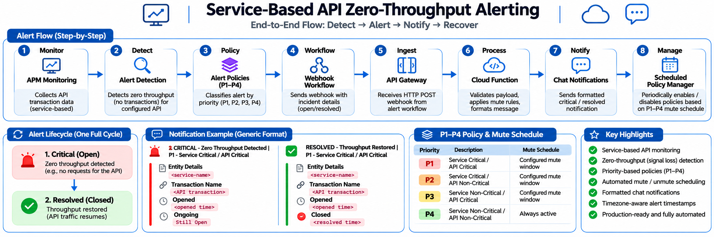
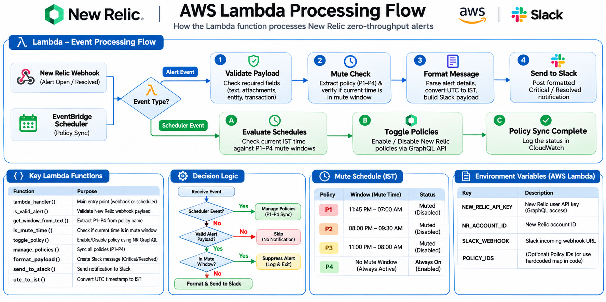
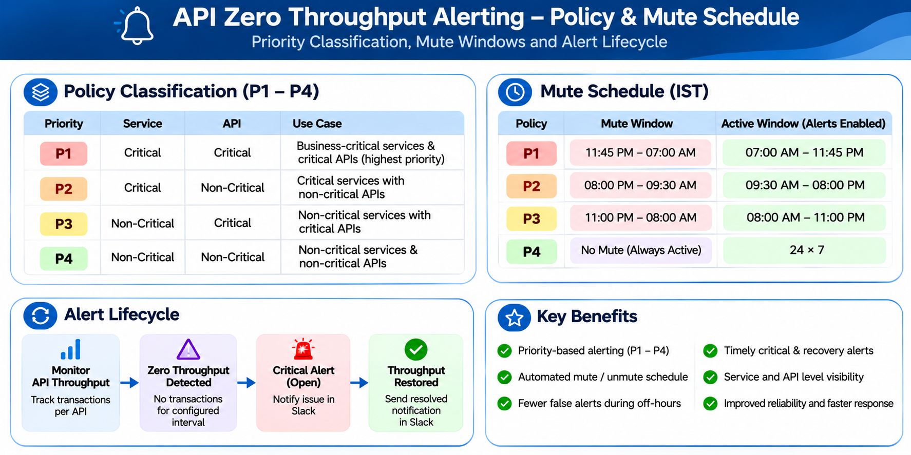

# 🚨 New Relic Zero-Throughput Alerting

Python · AWS Lambda · New Relic · API Gateway · Slack · Monitoring

## 📌 Overview

This project implements an automated **Service-Based API Zero-Throughput Monitoring and Alerting solution** using New Relic, AWS Lambda, API Gateway, and Slack.

The solution monitors API transaction activity and identifies zero-throughput conditions when configured APIs stop receiving transactions.

When a zero-throughput condition is detected, New Relic triggers an alert and sends incident information through a configured workflow to AWS API Gateway. AWS Lambda processes the incoming webhook, evaluates alert priority and mute schedules, formats the incident details, and delivers notifications to Slack.

The solution supports both **Critical (Open)** and **Resolved (Closed)** notifications, providing complete incident lifecycle visibility.

It also supports automated alert policy management based on configurable priority-based mute schedules.

## Technologies Used

- New Relic APM
- NRQL Alert Conditions
- New Relic Alert Policies
- New Relic Workflows
- AWS Lambda
- AWS API Gateway
- Amazon EventBridge Scheduler
- Python
- Slack Webhooks
- Monitoring & Observability

---

## 🏗️ Architecture

### Architecture Diagram



### Architecture Overview

1. New Relic collects API transaction data.
2. NRQL-based alert conditions identify zero-throughput situations.
3. Alert policies classify incidents according to priority.
4. New Relic Workflows send webhook notifications.
5. AWS API Gateway receives webhook requests.
6. AWS Lambda validates and processes incident details.
7. Lambda evaluates configured mute rules and formats notifications.
8. Slack receives Critical and Resolved notifications.
9. EventBridge Scheduler triggers periodic alert policy synchronization.

## 📚 Table of Contents

- Overview
- Architecture
- Features
- Repository Structure
- Screenshots
- Zero-Throughput Detection
- Environment Variables
- Setup Guide
- Workflow Payload
- Lambda Processing
- Policy Classification
- Incident Lifecycle
- Testing
- Troubleshooting
- Future Enhancements
- Resume Project Description

---

## ✨ Features

✅ Service-Based API Monitoring

✅ Zero-Throughput Detection

✅ Automated Incident Detection

✅ Priority-Based Alert Classification (P1–P4)

✅ Critical / Open Incident Notifications

✅ Resolved / Closed Incident Notifications

✅ Complete Incident Lifecycle Tracking

✅ Slack Alerting Integration

✅ New Relic Workflow Integration

✅ AWS Lambda Webhook Processing

✅ API Gateway Integration

✅ Automated Policy Mute / Unmute Scheduling

✅ EventBridge Scheduler Integration

✅ UTC to IST Timestamp Conversion

✅ Production-Oriented Alert Automation

---

## 📂 Repository Structure

```text
newrelic-zero-throughput-alerting/
│
├── README.md
│
├── .gitignore
├── .env.example
├── requirements.txt
│
├── assets
│   ├── architecture-diagram.png
│   ├── lambda-processing-flow.png
│   └── policy-mute-schedule.png
│
├── docs
│   ├── architecture.md
│   ├── policy-mute-schedule.md
│   ├── setup-guide.md
│   ├── troubleshooting.md
│   └── workflow-payload.md
│
├── lambda
│   └── lambda_function.py
│
└── screenshots
```

---

## 📸 Architecture & Workflow Diagrams

### 1️⃣ End-to-End Architecture

Illustrates the complete monitoring and alerting workflow, from API monitoring to notification delivery.


### 2️⃣ AWS Lambda Processing Flow

Illustrates how Lambda receives webhook and scheduled events, validates payloads, checks mute rules, formats notifications, and manages alert policies.



### 3️⃣ Policy Classification and Mute Schedule

Illustrates priority-based alert classification and the concept of configurable mute and active windows.



---

## 📈 Zero-Throughput Detection

The solution uses New Relic monitoring and NRQL-based alert conditions to identify APIs with no observed transaction activity.

Example NRQL query for transaction activity:

```sql
SELECT count(*)
FROM Transaction
WHERE appName = 'sample-service'
```

This query provides a basic view of transaction volume.

**Important:** Zero-throughput detection must be configured using the appropriate New Relic alert condition and signal-loss settings for the monitored API. A zero count from a query alone should not be treated as proof that an alert will trigger. Configure and validate the actual detection window and signal-loss behavior in New Relic.

---

## 🔐 Environment Variables

The Lambda implementation uses configuration values to communicate with New Relic and Slack.

| Variable | Description |
|---|---|
| NEW_RELIC_API_KEY | New Relic API authentication key |
| NR_ACCOUNT_ID / ACCOUNT_ID | New Relic account identifier; use the name expected by the deployed code |
| POLICY_IDS | Configured alert policy identifiers, if used |
| SLACK_WEBHOOK | Slack incoming webhook URL |

Example:

```env
NEW_RELIC_API_KEY=your_new_relic_api_key
NR_ACCOUNT_ID=your_new_relic_account_id
POLICY_IDS=your_policy_ids
SLACK_WEBHOOK=your_slack_webhook_url
```

> Configuration names must match the actual deployed Lambda implementation. Never commit real credentials, webhook URLs, account identifiers, or production policy IDs.

---

## ⚙️ Setup Guide

This section describes the main components of the solution. Actual production configuration should be documented separately and kept private.

### Step 1 – Configure Notification Channel

Create a dedicated notification channel in your chat platform.

Configure an incoming webhook for message delivery.

### Step 2 – Configure New Relic Alert Policies

Navigate to:

```text
Alerts & AI
    → Alert Policies
```

Create and configure alert policies according to service and API criticality.

### Step 3 – Configure Zero-Throughput Detection

Navigate to:

```text
Alerts & AI
    → Alert Conditions
```

Configure the required NRQL alert conditions and signal-loss behavior for the APIs being monitored.

Validate the detection behavior using non-production test traffic.

### Step 4 – Configure Webhook Destination

Configure a webhook destination using the API Gateway endpoint.

### Step 5 – Configure New Relic Workflow

Associate the relevant alert policies with the configured webhook destination.

Configure the payload to include the required incident information.

### Step 6 – Deploy AWS Lambda

Deploy the Python Lambda function and configure the required environment variables.

Ensure the Lambda execution role has the permissions required by the implementation.

### Step 7 – Configure API Gateway

Create an HTTP API endpoint.

Configure:

- Method: POST
- Integration: AWS Lambda
- Route: Configured webhook route

Verify that API Gateway can invoke the Lambda function.

### Step 8 – Configure EventBridge Scheduler

Configure scheduled execution for alert policy synchronization.

Validate the schedule and policy-management behavior in a test environment before using it in production.

---

## 📦 Workflow Payload

New Relic Workflow sends incident details to the configured webhook endpoint.

Example generic payload structure:

```json
{
  "text": "{{#if closedAt}}RESOLVED - Throughput Restored{{else}}CRITICAL - Zero Throughput Detected{{/if}}",
  "attachments": [
    {
      "fields": [
        {
          "title": "Entity Details",
          "value": "{{escape accumulations.metadata_entity_name.[0]}}"
        },
        {
          "title": "Transaction Name",
          "value": "{{escape accumulations.targetName.[0]}}"
        },
        {
          "title": "Opened",
          "value": "{{issueCreatedAt}}"
        },
        {
          "title": "Ongoing",
          "value": "{{#if closedAt}}{{issueClosedAt}}{{else}}Still Open{{/if}}"
        }
      ]
    }
  ]
}
```

The actual payload depends on the New Relic Workflow configuration and the fields available in the incident event.

---

## ⚡ Lambda Processing

The AWS Lambda function performs the following operations:

1. Receives incoming webhook or scheduled events.
2. Identifies the event type.
3. Validates incoming alert payloads.
4. Extracts incident and policy information.
5. Determines the applicable priority.
6. Checks whether the current time falls within a configured mute window.
7. Manages alert policy enablement and disablement for scheduled events.
8. Converts UTC timestamps to IST.
9. Formats Critical and Resolved notification messages.
10. Sends notifications through the configured Slack webhook.

### Lambda Processing Diagram


---

## 🎯 Policy Classification

The alerting implementation uses four priority categories based on service criticality and API criticality.

| Priority | Service Criticality | API Criticality |
|---|---|---|
| P1 | Critical | Critical |
| P2 | Critical | Non-Critical |
| P3 | Non-Critical | Critical |
| P4 | Non-Critical | Non-Critical |

### Mute Schedule Management

- P1, P2, and P3 use configurable mute windows.
- P4 remains continuously active.
- EventBridge Scheduler triggers policy synchronization.
- Lambda evaluates configured schedules and updates policy status through the New Relic API.

Actual production policy identifiers and internal schedules are intentionally excluded from this public repository documentation.


---

## 🚨 Incident Lifecycle

The solution supports both alert opening and recovery notifications.

### 1️⃣ Incident Opened

```text
Zero Throughput Detected
          │
          ▼
New Relic Alert Triggered
          │
          ▼
New Relic Workflow
          │
          ▼
AWS API Gateway
          │
          ▼
AWS Lambda Processing
          │
          ▼
Mute Rule Evaluation
          │
          ▼
Critical Notification to Slack
```

### 2️⃣ Incident Resolved

```text
API Traffic Restored
          │
          ▼
New Relic Incident Resolved
          │
          ▼
New Relic Workflow
          │
          ▼
AWS API Gateway
          │
          ▼
AWS Lambda Processing
          │
          ▼
Resolved Notification to Slack
```

This provides visibility throughout the incident lifecycle, from zero-throughput detection to service recovery.

---

## 🧪 Testing

Validate the complete workflow in a non-production environment.

### Test Webhook Processing

Trigger a test notification from the configured New Relic Workflow.

Verify:

- API Gateway receives the request.
- Lambda executes successfully.
- Incoming payload is processed correctly.
- Alert priority is identified correctly.
- Mute-window logic behaves as expected.
- Slack notification is delivered.
- Incident state is correctly displayed.

### Test Recovery Notification

Verify that a resolved incident generates the expected recovery notification.

### Test Scheduled Policy Management

Verify that scheduled events trigger policy synchronization and that policy states match the configured schedule.

---

## 🛠️ Troubleshooting

### Slack Notification Not Received

Verify:

- Slack webhook configuration.
- Lambda execution logs.
- API Gateway integration.
- New Relic Workflow configuration.
- Lambda network connectivity.

### Workflow Not Triggering

Verify:

- Alert condition configuration.
- Workflow activation.
- Policy association.
- Webhook destination configuration.
- Signal-loss settings.

### Lambda Errors

Check:

- Amazon CloudWatch Logs.
- Lambda execution role.
- Environment variable configuration.
- New Relic API response.
- API Gateway integration.

### Incorrect Incident State

Verify:

- Incoming webhook payload.
- Open and resolved event fields.
- Incident timestamps.
- Lambda alert-state detection logic.

### Incorrect Policy Scheduling

Verify:

- EventBridge Scheduler configuration.
- Lambda scheduled-event handling.
- Configured mute windows.
- New Relic API permissions.
- Policy update responses.

---

## 🚀 Future Enhancements

- Microsoft Teams Integration
- Email Notifications
- PagerDuty Integration
- ServiceNow Integration
- Monitoring Dashboard Automation
- Alert Analytics and Reporting
- Multi-Region Monitoring
- Automated Incident Remediation
- Advanced Alert Correlation

---

## 💼 Resume Project Description

**New Relic Service-Based API Zero-Throughput Monitoring & Alert Automation**

Designed and implemented an automated API zero-throughput monitoring and alerting solution using New Relic, NRQL, AWS Lambda, API Gateway, EventBridge Scheduler, and Slack. Implemented priority-based alert classification, automated policy mute/unmute scheduling, webhook-based incident processing, and Critical/Resolved notifications. Improved operational visibility into API traffic interruptions and supported faster incident detection and recovery.

### Technologies Used

- New Relic APM
- NRQL
- AWS Lambda
- AWS API Gateway
- Amazon EventBridge Scheduler
- Python
- Slack Webhooks
- Monitoring & Observability
- Incident Management
- Alert Automation

---

⭐ If you found this project useful, consider giving it a star.
