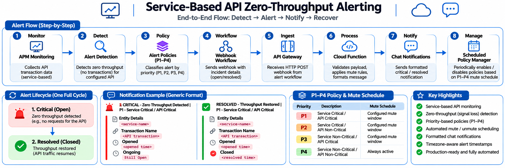

# Architecture – New Relic Zero Throughput Alerting

## 1. Overview

This document describes the architecture of the New Relic Zero Throughput Alerting solution.

The solution integrates New Relic, AWS API Gateway, AWS Lambda, and Slack to process zero-throughput alerts and manage New Relic alert policies.

## 2. Architecture Components

| Component | Responsibility |
|---|---|
| New Relic APM | Monitors application and transaction throughput |
| NRQL Alert Condition | Detects zero-throughput conditions |
| New Relic Workflow | Sends alert information through a webhook |
| AWS API Gateway | Receives the webhook and forwards the request to Lambda |
| AWS Lambda | Processes alert events and executes policy-management logic |
| New Relic API | Allows Lambda to update alert-policy status |
| Slack | Receives alert and resolution notifications |

## 3. Architecture Flow

1. New Relic monitors application and transaction throughput.
2. An NRQL alert condition detects when throughput reaches zero.
3. New Relic generates an alert event.
4. The configured New Relic workflow sends the event to the API Gateway endpoint.
5. API Gateway forwards the incoming request to AWS Lambda.
6. Lambda validates and processes the incoming payload.
7. Lambda evaluates the configured priority and mute/unmute rules.
8. When required, Lambda communicates with the New Relic API to update the relevant alert policy.
9. Lambda formats the notification and sends it to Slack.

## 4. Architecture Diagram

## 5. Lambda Responsibilities

The Lambda function handles the application logic for:

- Processing incoming webhook requests.
- Validating alert payloads.
- Extracting policy and alert information.
- Identifying the applicable priority category.
- Evaluating configured mute/unmute conditions.
- Enabling or disabling New Relic alert policies through the New Relic API.
- Formatting alert and resolution messages.
- Sending Slack notifications.

## 6. Priority-Based Policy Management

The solution uses four priority categories:

| Priority | Service Criticality | API Criticality |
|---|---|---|
| P1 | Critical | Critical |
| P2 | Critical | Non-Critical |
| P3 | Non-Critical | Critical |
| P4 | Non-Critical | Non-Critical |

The Lambda policy-management logic uses the applicable priority category to determine which New Relic alert policy should be managed.

## 7. Communication Flow

| Source | Destination | Purpose |
|---|---|---|
| New Relic | API Gateway | Sends alert webhook |
| API Gateway | AWS Lambda | Forwards webhook request |
| AWS Lambda | New Relic API | Updates alert-policy status |
| AWS Lambda | Slack | Sends alert notifications |

## 8. Security Considerations

- Store API keys and webhook URLs securely in Lambda environment configuration.
- Do not commit credentials or production identifiers to GitHub.
- Use appropriate IAM permissions for Lambda execution.
- Restrict access to API Gateway endpoints where applicable.
- Avoid publishing internal service names, account IDs, and policy IDs.

## 9. Important Notes

- API Gateway acts as the integration bridge between New Relic and Lambda.
- The policy mute/unmute logic is implemented inside the Lambda function.
- No Amazon EventBridge integration is included in this architecture.
- Lambda executes its logic when invoked; this document does not assume an additional scheduling service.
